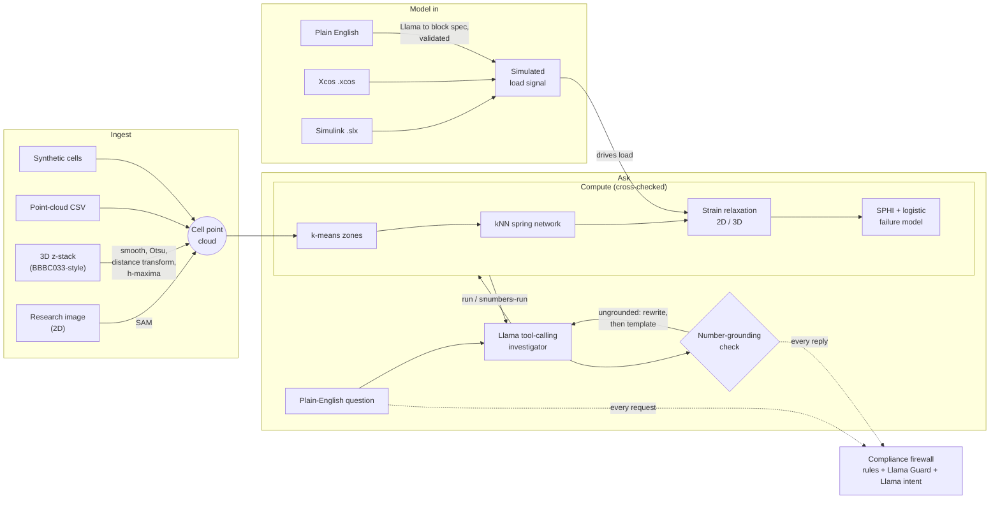

<div align="center">


# Mequa

### A quantitative workbench for tissue-mechanics research data

**Image or systems model in. Quantified strain out. Every number checked. Every request guarded.**

[](https://github.com/Versus-DEV/Mequa/actions/workflows/ci.yml)


Built solo for the **Meta Global AI Developer Hackathon** (Indie Dev Track · theme: *Push the Frontier*)

[Demo video](#demo) · [Quick start](#quick-start) · [Architecture](#architecture) · [Evidence](#measured-results) · [Limitations](#limitations-read-this)

</div>

---

> **What existed before the hackathon: nothing.** The repository was created on **Oct 28, 2026** and every file in it was written during the event. Third-party libraries and pre-trained models are listed under [Third-party software](#third-party-software); everything else is original work.

---

## Table of contents

1. [TL;DR](#tldr)
2. [Why Mequa exists](#why-mequa-exists)
3. [What it does](#what-it-does)
4. [Architecture](#architecture)
5. [Meta models and what each one does](#meta-models-and-what-each-one-does)
6. [The workspace (dashboard tour)](#the-workspace-dashboard-tour)
7. [The numerical core](#the-numerical-core)
8. [Three independent solvers that agree](#three-independent-solvers-that-agree)
9. [Zero-copy Rust bridge](#zero-copy-rust-bridge)
10. [Parallelism: two kinds of MPI](#parallelism-two-kinds-of-mpi)
11. [From images to cells](#from-images-to-cells)
12. [Model in, strain out: Simulink and Xcos](#model-in-strain-out-simulink-and-xcos)
13. [An agent that is not allowed to make numbers up](#an-agent-that-is-not-allowed-to-make-numbers-up)
14. [Compliance firewall](#compliance-firewall)
15. [MCP server](#mcp-server)
16. [Chat bots: WhatsApp and Messenger](#chat-bots-whatsapp-and-messenger)
17. [3D viewer and model editor](#3d-viewer-and-model-editor)
18. [Native launcher and two-machine mode](#native-launcher-and-two-machine-mode)
19. [Measured results](#measured-results)
20. [Quick start](#quick-start)
21. [Command reference](#command-reference)
22. [Repository map](#repository-map)
23. [Testing and CI](#testing-and-ci)
24. [Data and licenses](#data-and-licenses)
25. [Hackathon compliance](#hackathon-compliance)
26. [Limitations (read this)](#limitations-read-this)
27. [Roadmap](#roadmap)
28. [Third-party software](#third-party-software)
29. [License and author](#license-and-author)

---

## TL;DR

Researchers who study how tissue deforms under load spend days stitching one-off scripts together to get from a microscope image to a single number. **Mequa collapses that into one workspace that runs on a laptop with no GPU.**

| Step | What happens | Powered by |
|---|---|---|
| 1. **Ingest** | Segment cells in a public research image, detect nuclei in a 3D stack, load a point-cloud CSV, or generate synthetic cells | **SAM** (Meta), scikit-image, SciPy |
| 2. **Ask** | Describe the experiment in plain English; the model calls the solver as *tools*, sweeps the load, and finds where strain reaches a limit | **Llama 3.2 3B / 3.1 8B** (Meta, local) |
| 3. **Compute** | k-means density zones, spring-network strain relaxation (2D and 3D), connectivity check, the SPHI metric, a logistic failure model | **Julia** + **Rust** + **NumPy**, cross-checked |
| 4. **Couple** | Import a Simulink `.slx` or Scilab `.xcos` model (no MATLAB needed); its output signal drives the solver | Original importer + RK4 simulator |
| 5. **Guard** | Every request and every generated reply passes a three-layer firewall that blocks individual-level medical guidance | Rules + **Llama Guard 3** + **Llama 3.2** intent classifier |

Mequa **never** gives diagnosis, prognosis, or treatment guidance for any individual. It is an instrument for datasets, cohorts, and simulations.

---

## Why Mequa exists

Three problems kept showing up in tissue-mechanics and quantitative-biology workflows:

1. **The pipeline is fragmented.** Segmentation lives in one tool, mechanics in another, systems models in a third, and the glue is a folder of scripts that only one person understands.
2. **LLMs are tempting and untrustworthy around numbers.** An assistant that "explains" a result by inventing a plausible-looking figure is worse than no assistant.
3. **Biomedical tools attract advice-seeking.** A research instrument has to be built so it cannot quietly drift into telling an individual what to do about their health.

Mequa's answer is a single workspace, in the spirit of a trading terminal: *image, model, solver, questions and safety checks on one screen.* The design rules follow directly:

- **The model never computes physics.** Numbers come from the verified solver, nothing else.
- **Three independent implementations of the solver must agree**, so a bug in one cannot hide.
- **Every claim in this README is either measured or labelled as not measured.**
- **The safety layer is part of the architecture, not a disclaimer.**

---

## What it does



---

## Architecture

Mequa uses a **three-language design**: each language does the job it is best at, and the boundaries between them are tested.

```
┌──────────────────────────────────────────────────────────────────────┐
│  PYTHON  ·  surface, orchestration, safety                           │
│  Streamlit workspace · agent loop · firewall · MCP server · bots     │
│  image ingestion · Simulink/Xcos importers · reports · CLI tools     │
└───────────────┬───────────────────────────────┬──────────────────────┘
                │ juliacall                     │ PyO3 + rust-numpy
                ▼                               ▼
┌───────────────────────────────┐   ┌───────────────────────────────────┐
│  JULIA  ·  readable reference │   │  RUST  ·  fast kernel             │
│  solvers/MequaCore.jl  (2D)   │   │  rust/src/lib.rs                  │
│  solvers/MequaCore3D.jl (3D)  │   │  rayon-parallel relaxation        │
│  k-means, kNN grid search,    │   │  borrows NumPy buffers in place   │
│  relaxation, SPHI, Markov,    │   │  (zero-copy, CPU memory)          │
│  logistic fit                 │   │                                   │
└───────────────────────────────┘   └───────────────────────────────────┘
                ▲                               ▲
                └──────── NumPy/SciPy reference + fallback ─────────┘
                       (mequa/numpy_backend.py, always available)

  MPI (mpi4py) sits above all three:  load-sweep parallelism  +  domain-decomposed solve
```

**Why three languages?** Julia keeps the mathematics readable and close to the paper; Rust gives the fastest kernel and a safe memory boundary; NumPy guarantees the tool works on any machine. Because all three exist, `python -m mequa.crosscheck` can prove they produce the same answer.

---

## Meta models and what each one does

| Model | Where it runs | Role in Mequa |
|---|---|---|
| **SAM** (ViT-B, open weights) | Local (PyTorch, CPU) | Cell segmentation from research images; shape features (area, etc.) feed per-cell stiffness |
| **Llama 3.2 3B** | Local (Ollama) | Tool-calling investigator, plain-English → block specification, result summary, and the **request-intent classifier** inside the firewall |
| **Llama 3.1 8B** | Local (Ollama) | Optional larger planner/investigator (`PLANNER_MODEL`) |
| **Llama Guard 3 1B** | Local (Ollama) | Request and reply safety screening; Mequa blocks on category **S6** (specialized advice) |

**No non-Meta model is called at runtime.** Because everything is open-weight and local, research images and prompts never leave the machine.

Mequa also integrates with Meta's messaging platforms (see [Chat bots](#chat-bots-whatsapp-and-messenger)) and can export any conversation as a paste-ready block for Meta AI.

---

## The workspace (dashboard tour)

Launch with `streamlit run app.py`. The clean, light workspace has a status rail (dataset, language model, firewall) and an **Assistant** chat dock available on every page.

| Group | Page | What it does |
|---|---|---|
| **Analysis** | **Workbench** | Verified strain solver on Julia, Rust or NumPy, with evidence and Simulink import |
| | **SAM Mechanics** | Research image → masks → cells → per-cell stiffness |
| | **Image Lab** | Upload your own image or z-stack; nuclei are detected and sent to every other tool |
| | **3D Viewer** | WebGL: orbit, select, clip and measure cell models and PDB / XYZ molecules |
| | **Cell Viewer** | Quick 3D view of the current dataset |
| | **Model Editor** | Edit a cell model in three views, set stiffness, re-solve |
| **Intelligence** | **Adaptive Agent** | Llama calls the solver as tools, sweeps loads, writes a number-checked summary |
| | **Compliance Firewall** | Try a request; see which layer blocked it and why |
| | **Simulink Editor** | Plain English → validated block spec → simulation |
| **System** | **Benchmarks** | Measured solver and MPI scaling with the machine that produced them |
| | **Machines** | Choose where the firewall runs; health-check both nodes |

---

## The numerical core

All definitions below are deliberately simple and stated plainly. See [Limitations](#limitations-read-this) for what they are *not*.

**Cells → graph.** Each cell centre is a node. Edges come from a **k-nearest-neighbour graph** (a grid-accelerated search in Julia; SciPy's k-d tree for 3D in the Rust path).

**Strain model.** A simplified **spring network** over that graph. One edge of tissue is held, the opposite edge is pulled, and the network relaxes to equilibrium. Per-cell stiffness is a modelling assumption (derived from segmented area when SAM shape features are available). Diagnostics are reported everywhere: number of connected components, whether a **load path** connects the held and pulled edges, and the residual force.

**Zones.** **k-means** partitions cells into density zones; per-zone strain statistics are reported.

**SPHI (Systemic Propagating Hazard Index).** The leading eigenvalue of the neighbour graph weighted by mean strain. It grows with graph size and neighbour count, so **compare SPHI only between meshes built the same way.**

**Failure model.** A logistic function of strain centred on the 90th-percentile strain, with a fitted/width parameter. It is a *simulation output with a stated threshold*, not a clinical prediction.

**Markov chains.** `markov_estimate` and `stationary_distribution` in the Julia core estimate transition matrices and stationary distributions over discrete states.

**Load sweep.** Sweep the applied load and find where the 95th-percentile strain reaches a strain limit. This is the question the agent answers.

---

## Three independent solvers that agree

| Implementation | File | Role |
|---|---|---|
| **Julia** | `solvers/MequaCore.jl`, `solvers/MequaCore3D.jl` | Readable reference solver (threaded relaxation for 5,000+ cells) |
| **Rust** (PyO3 + rayon) | `rust/src/lib.rs` | Fast kernel |
| **NumPy / SciPy** | `mequa/numpy_backend.py` | Always-available baseline and fallback |

```bash
python -m mequa.crosscheck
```

Measured on identical points (Oct 29): SPHI relative difference vs NumPy **5.2e-14** (Rust) and **5.1e-14** (Julia); largest per-cell strain difference **1.3e-13**; **7,295 edges** in all three. The NumPy and Rust relaxation kernels also agree to **1e-9** in 2D and 3D (`tests/test_rust_3d.py`), and CI checks the standalone Julia 3D kernel against a NumPy reference (`julia solvers/test_3d.jl`).

---

## Zero-copy Rust bridge

Moving arrays between languages is where scientific Python usually loses its speed. Mequa's Rust module **borrows NumPy buffers in place** instead of copying them.

```bash
python -m mequa.zero_copy_check
```

This compares the memory address Rust sees with the address NumPy reports, and does the same for a **PyTorch CPU tensor**. Wrong-layout inputs (for example `float32` or Fortran-ordered arrays) are **rejected rather than silently copied**, so a performance cliff can never hide behind a "works" result.

*Scope: CPU memory only. GPU device pointers are not supported (see [Roadmap](#roadmap)).*

---

## Parallelism: two kinds of MPI

Mequa ships two genuinely different MPI strategies (details in [`docs/DOMAIN_DECOMPOSITION.md`](docs/DOMAIN_DECOMPOSITION.md)):

| | `mequa.mpi_sweep` | `mequa.domain_mpi` |
|---|---|---|
| **What is split** | The list of loads; each rank solves different loads on the whole mesh | One mesh; each rank owns a slab of nodes |
| **Communication** | None until the final gather | Halo exchange of boundary-node positions every relaxation step |
| **Helps when** | Many loads or parameter settings | A single solve is too large for one rank |
| **Verified** | Identical to serial and across rank counts (max difference 0.0) | Identical to serial to 1e-9 on 1-4 ranks, 2D and 3D |

```bash
mpiexec -n 4 python -m mequa.domain_mpi --cells 20000 --dim 3 --verify
python -m mequa.domain_scaling      # repeated, interleaved timing with a noise flag
```

> **Honest speedups.** Speed depends on size and machine. In a few-core sandbox at 6,000 cells, domain decomposition was *not* faster than serial. On the author's 8-thread laptop, one 20,000-cell 3D run on 4 ranks took 1.48 s vs 3.51 s serial (2.4x), a **single run**. Only the repeated table in [Measured results](#measured-results) should be quoted.

---

## From images to cells

| Source | Method | Notes |
|---|---|---|
| **2D research image** | **SAM** automatic masks on a point-prompt grid → cell centres + shape features | Prompt grid is a setting, not a default: coarse and fine grids trade recall for speed |
| **3D z-stack** | Smooth → Otsu → distance transform → **h-maxima** (one marker per nucleus) | 16-bit TIFF and multi-page stacks supported; percentile stretch; watershed splitting of touching cells |
| **Point-cloud CSV** | Direct load | |
| **Synthetic cells** | Seeded multi-cluster generator | Used for tests and scaling runs |

**Scoring against experts.** `mequa.eval_segmentation` and `mequa.real3d` score detections against expert masks two ways (centroid match and inside-instance match, with splits counted) and report diagnostics such as per-z profiles and missed nuclei, so a low score can be *diagnosed* instead of guessed at.

On one public image (**BBBC039**, 110 expert-marked nuclei), SAM detected **104** with precision **1.00** and **F1 0.97** at the finest prompt grid; at a coarse grid F1 was **0.81**. Both numbers are regenerated by `make_report` into `results/RESULTS.md`.

---

## Model in, strain out: Simulink and Xcos

Systems models often describe the *load* a tissue sees (for example a blood-pressure waveform). Mequa lets that model drive the solver.

- **Simulink `.slx` without MATLAB** (`mequa/simulink.py`): reads the file, evaluates block parameters with a **restricted math parser**, and simulates the diagram with a fixed-step **RK4** solver (10 block types).
- **Scilab Xcos `.xcos`** (`mequa/blockspec/xcos_reader.py`): a free alternative path.
- **Plain English → block spec** (`mequa/blockspec/`): Llama names a *standard form and its parameters* (for example "second-order, natural frequency 2, damping 0.3"); **program code does the arithmetic**, and a **validator rejects anything unsupported, with a reason**, before it is simulated.
- **Coupling:** `python -m mequa.slx_cli --demo --couple` imports a generated 2-element **Windkessel** model and uses its pressure signal to drive the strain solver quasi-statically.

*The Xcos reader is tested on hand-built files in the documented layout, not on files exported by Scilab. Simulink coverage is a small block subset.*

---

## An agent that is not allowed to make numbers up

The **Adaptive Agent** (`mequa/agents/adaptive_investigator.py`) lets Llama act as a computational scientist: run the solver, read results, decide what to run next.

- **The model never computes physics.** Every number comes from the verified solver via tool calls.
- **Tool arguments are validated and clamped; the loop is bounded.**
- **Number grounding** (`number_grounding.py`): a final answer containing a number that is *not* in a tool result is sent back for rewriting; after repeated failure it is **replaced by a template built only from tool results**.
- **Connectivity-aware.** If a result reports that the pulled edge is not connected to the held edge, the agent is told to re-run with more neighbours *before trusting any strain value*.
- **Threshold questions require a sweep.** If the model answers without one, it is told once to run it, and the final summary always states the sweep threshold.
- **Request and reply both pass the firewall.**

Example:

```bash
python -m mequa.agent "At what load does the 95th percentile strain reach the strain limit?"
```

---

## Compliance firewall

Mequa is a research tool. The firewall is how that is *enforced*, not just stated.

**Three layers on every request, plus a reply check:**

| Layer | Mechanism | Strength |
|---|---|---|
| 1. **Rules** | Regular expressions (patient/treatment/dose phrasing, "my tumour/scan/biopsy", dosage units, "should I take...") | Fast, transparent, brittle on its own |
| 2. **Llama Guard 3 1B** | Blocks on category **S6** (specialized advice) | Catches advice requests; other categories are treated as flags because they false-positive on words like "load" and "benchmark" |
| 3. **Llama 3.2 intent classifier** | Few-shot `clinical_advice` vs `research_analysis` with the definition that dataset/cohort mentions of tumours or cells are research | Strongest single layer |

Replies are re-checked before display. A clinical request halts with a red status; a research request clears green.

### How it was evaluated

| Set | Result | Independence |
|---|---|---|
| Round 3 (30 queries: 15 research, 15 clinical) | **Blocked 15/15 clinical, wrongly blocked 0/15 research** | Written before first run (partly informed by earlier rounds) |
| Round 5 (adversarial English: role-play, injection, disguised requests; 15 clinical, 12 research) | **15/15 blocked, 0/12 wrongly blocked** | Adversarial |
| Leave-one-layer-out ablation, round 3 | Without the Llama intent layer: **8/15** | Shows what each layer is responsible for |
| Leave-one-layer-out ablation, round 5 | Without the Llama intent layer: **13/15** | |
| Single layers, round 3 | Intent alone 15/15 · Llama Guard S6 alone 7/15 · rules alone 2/15 | |

> **Caveats, stated plainly:** the sets are small and written by the author (a perfect 15/15 still allows a true miss rate of up to ~20%); the firewall is **English only**; if the guard model is unreachable the verdict is marked `degraded`. The full table, including every round, is generated into `results/RESULTS.md`.

Run the evaluations:

```bash
python -m mequa.eval_firewall
python -m mequa.eval_all
python -m mequa.eval_heldout
```

---

## MCP server

`mequa/mcp_server.py` exposes Mequa over the **Model Context Protocol**, so any MCP client can use it:

| Tool | What it does |
|---|---|
| `compliance_check` | Runs the firewall on a piece of text; returns allowed/blocked, blocking layers, categories, degraded flag |
| `analyze_cells` | Strain analysis on synthetic cells (SPHI, critical strain, per-zone stats) on `julia`, `rust` or `numpy` |
| `simulate_simulink` | Imports a `.slx` without MATLAB and simulates it (inputs bounded) |
| `run_experiment` | Plain-language experiment through the agent |

```bash
python -m mequa.mcp_server
```

---

## Chat bots: WhatsApp and Messenger

A standalone bot (`mequa/bot/`) lets you run the verified solver from a chat. Webhook servers use only the standard library, verify signatures, de-duplicate messages, and share one channel-independent core.

| You send | It does |
|---|---|
| `help` | Menu with **Analyze**, **Sweep**, **Strain map** buttons |
| `analyze 5` | Solves at 5% load; reports strain, SPHI and zones (solver numbers only, no LLM) |
| `sweep 5` | Sweeps 8 loads; reports where p95 strain reaches the limit |
| `map 5` | Sends a strain-map PNG (2D datasets) |
| `status` | Models and dataset |

```bash
python -m mequa.bot.console                # same bot in your terminal, no account needed
python -m mequa.bot.whatsapp_server        # WhatsApp webhook
python -m mequa.bot.messenger_server       # Messenger webhook
```

Setup: [`docs/BOT_SETUP.md`](docs/BOT_SETUP.md), [`docs/MESSENGER_SETUP.md`](docs/MESSENGER_SETUP.md). The chat dock can also **export a conversation** as PDF, Markdown, or a paste-ready block for Meta AI ([`docs/EXPORT_SETUP.md`](docs/EXPORT_SETUP.md)).

---

## 3D viewer and model editor

- **WebGL 3D Viewer** (`mequa/viewer/`): orbit, select, clip and measure cell models; loads **PDB** and **XYZ** molecule files.
- **Model Editor** (`mequa/editor/`): edit a cell model in three views, set per-cell stiffness, then re-solve; the viewer is embedded.
- **Shared workspace dataset**: load cells once in Image Lab or Workbench and every page (viewer, editor, assistant, bots) uses them.

---

## Native launcher and two-machine mode

**Rust launcher** (`launcher/`): a native window that starts and stops the dashboard and Ollama, shows live status for each, streams their logs, and opens the browser. Build with `cd launcher && ./build.sh` (or `.\build.ps1` on Windows). No Rust? `Start_Mequa.bat` is a fallback.

**Two-machine mode** ([`README_2_MACHINE.md`](README_2_MACHINE.md)): run the dashboard, SAM, solver and planner on a main laptop, and **Llama Guard plus the intent classifier on a second laptop** on the local network. Guard mode is `auto`, `dedicated` or `main`. This is *not* RAM pooling; it is a small local cluster, and it must not be exposed to the public internet (`NETWORK_MODE=local_only`).

```bash
python -m mequa.envcheck           # check both nodes
python -m mequa.doctor             # environment diagnosis
```

---

## Measured results

Everything in this section is generated by `python -m mequa.make_report` from files in `results/`. Nothing is typed by hand; "not measured" means no result file exists yet.

<!-- RESULTS:START -->
not measured yet: run `python -m mequa.make_report`
<!-- RESULTS:END -->

**Earlier hand-recorded checkpoint (Oct 29, author's 8-thread laptop, before the Julia kernel upgrade).** Treat as historical; the generated table above supersedes it.

| Cells | NumPy | Rust | Julia |
|---:|---:|---:|---:|
| 1,000 | 0.460 s | 0.047 s (**9.8x**) | 0.060 s (7.7x) |
| 5,000 | 2.104 s | 0.231 s (**9.1x**) | 0.483 s (4.4x) |
| 10,000 | 4.283 s | 0.329 s (**13.0x**) | 1.276 s (3.4x) |

Since then Julia gained a grid neighbour search (identical results, ~2.7x faster at 10,000 cells in a one-core sandbox) and threaded node-wise relaxation for 5,000+ cells. Those need re-measuring on the 8-thread machine. Julia is presented as the **readable reference solver** and Rust as the **fast kernel**, cross-validated.

---

## Quick start

**Requirements:** Python 3.12, [Julia](https://julialang.org/downloads/), [Ollama](https://ollama.com), and (optionally) Rust (`rustup.rs`) and an MPI runtime. Windows and Linux were tested; macOS was not.

```bash
# 1. Python dependencies
pip install -r requirements.txt
# CPU PyTorch (needed for SAM)
python -m pip install torch torchvision --index-url https://download.pytorch.org/whl/cpu

# 2. Meta models (local, via Ollama)
ollama pull llama3.2:3b
ollama pull llama3.1:8b
ollama pull llama-guard3:1b

# 3. SAM checkpoint
python scripts/download_sam_checkpoint.py

# 4. Optional: build the Rust kernel
cd rust && maturin build --release && pip install target/wheels/*.whl && cd ..

# 5. Verify everything
python -m mequa.doctor
python -m pytest -q

# 6. Launch the workspace
streamlit run app.py          # or double-click Start_Mequa.bat on Windows
```

Copy `.env.example` to `.env` to choose models and the guard machine. Optional MPI: install the MS-MPI runtime and SDK (Windows) or OpenMPI (Linux), then `pip install mpi4py`.

### 60-second tour for judges

1. `streamlit run app.py` → open **Image Lab** → choose *Synthetic test stack* → nuclei appear and flow to every page.
2. **Adaptive Agent** → ask *"At what load does the 95th percentile strain reach the strain limit?"* → watch the tool-call trace, then the number-checked summary.
3. **Simulink Editor** → load `data/demo_windkessel.slx` → simulate → drive the strain solver.
4. **Compliance Firewall** → type a clinical request (blocked, red) → then a research request (cleared, green).
5. **Benchmarks** → solver and MPI scaling with the machine that produced them.

---

## Command reference

| Command | What it does |
|---|---|
| `streamlit run app.py` | The workspace |
| `python -m mequa.agent "<question>"` | Run the tool-calling investigator from the terminal |
| `python -m mequa.crosscheck` | Julia vs Rust vs NumPy on identical points |
| `python -m mequa.zero_copy_check` | Prove zero-copy memory sharing |
| `python -m mequa.benchmark` | Solver timing across backends |
| `python -m mequa.slx_cli --demo --couple` | Import demo Simulink model and drive the solver |
| `mpiexec -n 4 python -m mequa.domain_mpi --cells 20000 --dim 3 --verify` | Domain-decomposed solve |
| `python -m mequa.mpi_scaling` | Load-sweep scaling with interleaved repeats |
| `python -m mequa.real3d --volume <zip> --gt <tif> --out results/real3d.json` | Real 3D nuclei → strain (BBBC033) |
| `python -m mequa.eval_firewall` / `eval_all` / `eval_heldout` | Firewall evaluation rounds |
| `python -m mequa.eval_agent --models llama3.2:3b llama3.1:latest ...` | Agent evaluation |
| `python -m mequa.eval_segmentation` / `eval_blockspec` | Segmentation and block-spec evaluation |
| `python -m mequa.make_report` | Regenerate the measured-results section and `results/RESULTS.md` |
| `python -m mequa.mcp_server` | Start the MCP server |
| `python -m mequa.bot.console` | Chat bot in the terminal |
| `python -m mequa.doctor` / `envcheck` | Environment diagnosis |
| `julia solvers/test_3d.jl` | Julia 3D kernel parity with NumPy |

More measurement scripts: [`docs/RUN_THESE.md`](docs/RUN_THESE.md).

---

## Repository map

```
Mequa/
├── app.py                      Streamlit entry: themed shell, grouped navigation, home
├── views/                      Dashboard pages (workbench, SAM, Image Lab, viewer, editor,
│                               agent, firewall, Simulink, benchmarks, machines)
├── mequa/
│   ├── backend.py · numpy_backend.py · julia_bridge.py · rust_backend.py
│   ├── session.py · workspace.py · parallel.py · couple.py · worker.py
│   ├── ingest.py · imagelab.py · real3d.py · vision/        SAM + image → cells
│   ├── physics/                                             stiffness from geometry
│   ├── simulink.py · blockspec/                             .slx / .xcos / plain English
│   ├── agent.py · agents/                                   Llama tool-calling + grounding
│   ├── firewall.py · guard/ · mcp_server.py                 safety + MCP
│   ├── mpi_sweep.py · mpi_scaling.py · domain_mpi.py · domain_scaling.py
│   ├── viewer/ · editor/ · ui/ · chat.py · export_chat.py
│   ├── bot/                                                 WhatsApp + Messenger + console
│   └── eval_*.py · crosscheck.py · zero_copy_check.py · benchmark.py · make_report.py
├── solvers/                    MequaCore.jl · MequaCore3D.jl · tests · Bench.jl
├── rust/                       PyO3 + rayon kernel (maturin)
├── launcher/                   Native Rust launcher (eframe)
├── scripts/                    SAM download/run, BBBC039 prep, 3D reference
├── data/                       demo image, demo .slx, example .xcos, 3D reference
├── benchmarks/                 raw benchmark JSON with timestamps
├── docs/                       MPI, bots, UI, export, run guides, status
├── tests/                      pytest suite (Python, Julia, Rust, MPI, UI, bots)
├── viewer_src/                 WebGL viewer source
└── .github/workflows/ci.yml    Python 3.12 + Julia + OpenMPI + Rust build
```

---

## Testing and CI

- **Suite:** the pytest suite covers the solvers, Rust and Julia bridges, 3D kernels, MPI, ingestion, segmentation, Simulink/Xcos, block specs, agent grounding, firewall, bots, viewer and dashboard pages. Latest recorded run: **207 passed, 6 skipped** (sandbox, v6.3). Earlier on the author's laptop: 61 passed including Julia and Rust.
- **CI** (`.github/workflows/ci.yml`) on every push and PR: Python 3.12, Julia, OpenMPI, builds the Rust module with maturin, runs the Julia 3D parity test, then `pytest`.
- **Not run by anyone yet** (tracked in `PROGRESS.md`): items are listed there rather than hidden.

---

## Data and licenses

- **BBBC039**: U2OS nuclei with expert masks, used for segmentation scoring. CC0 per the dataset page.
- **BBBC033**: mouse trophoblast stem cell nuclei, 3D, expert labels, 0.5 um z-spacing. CC0 per the dataset page: "Nicolas Rivron has waived all copyright and related or neighboring rights". Cite: Rivron et al. 2018, *BBBC033v1*, Broad Bioimage Benchmark Collection (Ljosa et al., *Nature Methods*, 2012).
- **Synthetic point clouds** for tests and scaling runs.
- Image licence checks are recorded in `data/images/LICENSE_CHECK.md`.

---

## Hackathon compliance

**Track:** Indie Dev · **Theme:** *Push the Frontier* (accelerate a scientific experiment).

| Rule | How Mequa meets it |
|---|---|
| **New work only** | Repository created Oct 28, 2026; every file written during the event |
| **Open source** | Public repository, MIT licence |
| **Meta models incorporated** | SAM, Llama 3.x, Llama Guard 3 each have a real job ([table](#meta-models-and-what-each-one-does)) |
| **Not medical advice** | Three-layer firewall; evaluation reported with ablation |
| **Not a basic RAG app** | No retrieval; models drive a numerical solver |
| **Not a simple image analyzer** | Segmentation feeds a mechanics solver, an agent loop and a model importer |
| **No personality, nutrition, sports, political or war content** | None |
| **Clear original contribution** | Everything in this repo is original except [third-party software](#third-party-software) |

**Built during the hackathon:** the Julia, Rust and NumPy solvers; the Python bridges; the firewall and its evaluation; the tool-calling agent with number grounding; image and 3D ingestion; the Simulink/Xcos importers and block-spec writer; MPI strategies; the dashboard, viewer and editor; the MCP server; the chat bots; the native launcher; the benchmark and report harness.

---

## Limitations (read this)

Mequa is deliberately honest about what it is not.

- **The strain model is simplified.** It is a spring network, and stiffness per cell is a modelling assumption. It is not a validated tissue model.
- **SPHI is our own metric.** Compare values only between meshes built the same way.
- **Failure probability is a simulation output**, not a prediction.
- **The firewall is English only**, and its evaluation sets are small and author-written.
- **The agent was measured on synthetic meshes**, not on a real mesh from an image; the image-to-strain path is shown on one public image.
- **CPU only.** There is no GPU or CUDA path. Zero-copy covers CPU memory. (No GPU to test so had to delibrately leave it)
- **Rust neighbour search is 2D only**; 3D edges come from SciPy's k-d tree.
- **Domain-decomposed MPI matches serial but is not always faster**; speedup depends on size and machine.
- **Simulink coverage is a small block subset**; the Xcos reader is tested on hand-built files.
- **CPU inference makes an agent run take around a minute**, and the first call after startup is slower while the model loads.
- **Windows and Linux were tested; macOS was not.**

---

## Roadmap

Planned, **not built**, and not claimed anywhere above:

| Idea | Status |
|---|---|
| **GPU path** (CUDA kernels in Julia, device-pointer handoff from PyTorch/TensorFlow via `__cuda_array_interface__`) | Not started: the project was developed on a machine without an NVIDIA GPU |
| **AVX-512 / explicit SIMD tuning** | Not started |
| **Monte Carlo and wider stochastic modules** | Not started (Markov estimation exists in the Julia core) |
| **Native VTK / PyVista / DICOM pipelines** | Not started (a WebGL viewer ships today) |
| **Meta Model API (Muse) integration** for hosted agents | Not started; today everything runs locally |
| **Validated constitutive models** (beyond the spring network) | Future research |
| **Mesh agent evaluation**, multilingual firewall, macOS support | Future work |
| **A one-command build** across platforms | Future work |

---

## Third-party software

Julia, juliacall, NumPy, SciPy, scikit-image, tifffile, pandas, Pillow, Plotly, Streamlit, mpi4py, PyO3, rust-numpy, rayon, eframe, Ollama, segment-anything, PyTorch, the MCP Python SDK, fpdf2. **Models:** Llama, Llama Guard and SAM from Meta, used as released. Mequa's own contribution is how these pieces are combined, verified and guarded, plus all code in this repository.

---

## License and author

Released under the [MIT License](LICENSE). Copyright (c) 2026 Versus-DEV.

Built solo by **Versus**, a civil engineering student, for the Meta Global AI Developer Hackathon.

<div align="center">

**Research data only. No clinical guidance for any individual.**

</div>
